# 💫 About Me:
Hi, I'm Kapish Rawat, a first-year BCA student passionate about technology, programming, and building solutions that solve real-world problems.  💻 I'm exploring software development, Artificial Intelligence, and emerging technologies while continuously improving my technical and problem-solving skills.  🚀 I enjoy participating in hackathons, collaborating with teams, and turning innovative ideas into meaningful projects.  🌱 Currently, I'm focused on learning new technologies, strengthening my coding fundamentals, and growing as a developer.  🤝 I'm always open to collaborating on interesting projects, learning from fellow developers, and contributing to the tech community.  “Learning by building, growing by collaborating, and innovating with purpose.”

## 🌐 Socials:
     

# 💻 Tech Stack:
        
# 📊 GitHub Stats:
 
 

### 🔝 Top Contributed Repo

---

### 📈 Contribution Graph - This fixes your green boxes part

<!-- Proudly created with GPRM ( https://gprm.itsvg.in ) -->
